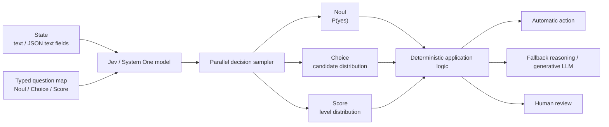
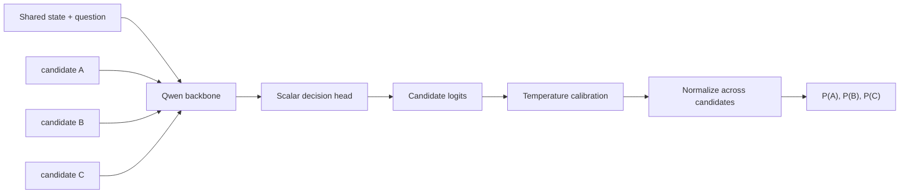
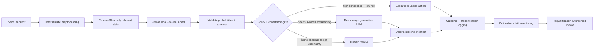
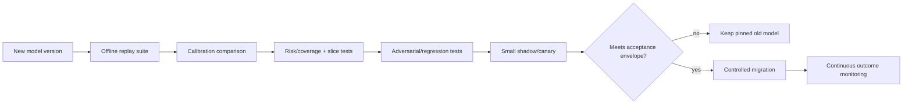

# Jev and Jev-Like Decision Models: Architecture, Training, Deployment, Evaluation, and Ecosystem

## Executive summary

**Jev** is TypeSafe AI's first public **System One model**, released on September 15, 2026. It is not designed to be a general-purpose text generator. Its defining contract is: provide unstructured or structured textual state plus one or more explicitly typed questions, and receive bounded decisions with probabilities instead of open-ended prose. TypeSafe exposes three primitives—`Choice`, `Score`, and `Noul`—and says Jev uses a new model architecture, a parallel sampler, and a post-training method it calls **Reinforcement Learning for Calibrated Decisions (RLCD)**. As of September 30, 2026, the current documented production model is `jev-1.13.0`. citeturn19view0turn16view1turn19view3

The most important caveat is that **“Jev architecture” is currently much less public than “Transformer architecture.”** TypeSafe has disclosed the system-level interface, behavior, RLCD objective at a conceptual level, performance claims, failure modes, and serving contract, but the public material reviewed for this report does **not** disclose Jev's parameter count, layer topology, attention/state-space components, tokenizer details, base checkpoint, optimizer, training corpus composition, RLCD reward/loss equation, or training compute. Therefore, claims that Jev itself is, for example, a small Transformer with a classification head should be treated as speculation. Open implementations such as Open-Jev and Jeeves use Qwen-family backbones, but they explicitly do **not** claim to reproduce TypeSafe's proprietary model. citeturn19view0turn19view2turn17view4turn17view7

Architecturally, the key distinction is **output-space specialization**. A GPT-style decoder predicts the next token repeatedly and can in principle emit arbitrary strings; Jev restricts inference to caller-defined decision spaces and returns probability distributions. That makes Jev particularly attractive when the desired operation is already naturally a function such as “which route?”, “does this satisfy a policy?”, “how severe is this?”, or “which action should an agent take?”. The Transformer and GPT lineage deliberately optimize flexible sequence generation; Jev sacrifices that flexibility to make the inference interface machine-native and bounded. citeturn14view0turn14view2turn16view2

The practical payoff is potentially large. TypeSafe lists Jev at **$0.042 per million input tokens, with output tokens free**, a 64K-token request context, 100K input tokens/s and 40 requests/s under the currently documented default limits. TypeSafe reports roughly **70–500 ms** end-to-end latency and, on its own workflow evaluations, gains as high as 193.6× in speed and 444.6× in cost; importantly, TypeSafe itself says those figures are likely toward the high end of real-world gains and notes possible evaluation bias. A separate Open-Jev project measured Jev 1.13 at about **295 ms median** on one customer-service workload from the same client used to test its local implementation. These figures are not universal benchmarks and should not be generalized to arbitrary reasoning workloads. citeturn16view1turn19view0turn20view0

Open-source work appearing immediately around Jev supports the general design thesis without establishing that TypeSafe's implementation has been reverse engineered. **Open-Jev** implements Jev-like dynamic decisions using Qwen-family models, LoRA adapters, a trained scalar decision head, a loss combining soft cross-entropy and Brier score, and post-hoc temperature calibration. **Jeeves**, from PostHog, takes a different direction: Qwen3.5-9B, LoRA, a pointer-style decision head, SFT followed by CISPO reinforcement learning, and optionally an autoregressive reasoning chain accelerated with a diffusion drafter. Jeeves reports materially better accuracy than Jev on the public JevBench subset, but full reasoning raises median latency from roughly 0.3 s without thinking to 3.3 s with thinking and 17.1 s at p90—illustrating the central accuracy-versus-latency tradeoff. citeturn17view6turn18view2turn18view3

The strongest case for Jev is therefore **not “Jev replaces LLMs.”** It is a heterogeneous architecture in which code and deterministic systems own arithmetic, invariants, authorization, and workflow control; a Jev-like model supplies cheap semantic judgments; a reasoning/generative LLM is invoked only when synthesis or difficult deliberation is required; and humans receive low-confidence or high-consequence cases. TypeSafe's own documentation recommends precisely this style of decomposition. citeturn16view2turn19view1turn17view0

The largest technical risks are also clear. A bounded schema prevents arbitrary malformed text, but **does not prevent wrong decisions**. TypeSafe documents weaknesses involving literal phrasing, counting, arithmetic, dates, multi-hop indirection, irrelevant long context, adversarial content, contradictory criteria, and cross-question structural consistency. Calibration is an aggregate statistical property rather than a guarantee that a particular 0.97-confidence answer is correct. Thus the vendor's phrase “zero hallucinations” should be interpreted narrowly as an **output/schema guarantee**, not as zero semantic error. citeturn19view0turn16view2turn17view0turn17view2

### Bottom-line positioning

| Question | Assessment |
|---|---|
| Is Jev a new general-purpose LLM replacement? | **No.** It deliberately gives up arbitrary text generation for bounded probabilistic decisions. citeturn19view0turn16view2 |
| Is it merely JSON mode? | **No at the interface/training level.** TypeSafe says the architecture, sampler, and RLCD training are decision-specific rather than an autoregressive generator constrained at decoding time. Internal details remain undisclosed. citeturn19view0turn19view2 |
| Is it just a classical classifier? | **Not quite.** Unlike a fixed classifier head with a fixed label set, Jev accepts natural-language state, dynamically specified questions, criteria, and candidate sets at inference time. citeturn16view0turn19view3 |
| Where is it strongest? | High-volume classification, routing, ranking, gating, policy judgments, semantic extraction into bounded values, agent action selection, and other low-latency “smart if-statement” workloads. citeturn19view0 |
| Where should GPT-style models remain preferred? | Open-ended generation, explanation, coding, synthesis, difficult multi-step reasoning, creative tasks, and tasks whose output space cannot sensibly be enumerated. citeturn16view2turn17view0 |
| How mature is the category? | **Very early.** Jev launched September 15, 2026; TypeSafe still describes changing rate limits and early-stage behavior, while most open implementations are weeks-old experimental projects. citeturn19view0turn16view1turn17view3 |
| Biggest unknown? | The proprietary Jev model's actual neural architecture, scale, full training recipe/data, and independent production-scale benchmark record. citeturn19view0turn19view2 |

## Definitions, scope, and historical context

### What “Jev” means

Within current machine-learning discussion, **Jev** most plausibly means TypeSafe AI's first “System One” decision model. TypeSafe describes a System One model as taking text or structured textual state and returning typed answers plus probabilities rather than generating a response. The product name “System One” is inspired by the fast/intuitive “System 1” terminology popularized by Daniel Kahneman; TypeSafe says “Jev” itself is named after economist William Stanley Jevons. citeturn16view2turn19view0

“Jev” is otherwise an under-specified string—it appears in unrelated non-ML contexts—but no comparably established competing ML architecture using exactly that name surfaced in the primary-source review. Accordingly, this report uses **Jev = TypeSafe's model** unless qualified otherwise.

**“Jev-like,” however, is not a standardized research taxonomy.** The most useful operational definition, supported by emerging projects and the NumericJev paper, is:

> A model or inference system is *Jev-like* when it accepts natural-language state and dynamically described, bounded choices at inference time and directly exposes typed decisions and/or probability distributions over those choices, rather than relying on unconstrained free-form answer generation.

NumericJev explicitly describes its setting as a fixed structured-choice interface where candidates can change at inference time, distinguishing this from an ordinary classifier with a permanent label head. citeturn18view6

That definition yields several distinct categories:

| Category | Output mechanism | Candidate space | Representative example |
|---|---|---|---|
| Classical classifier | Classification head | Usually fixed during training | BERT fine-tuned classifier |
| Cross-encoder / reward model | Scalar or pairwise score | Candidates supplied externally | Ranking/reward modeling |
| GPT + structured decoding | Autoregressive tokens constrained by grammar/schema | Dynamic | GPT-style JSON/schema output |
| Native Jev-like decision model | Direct candidate probabilities / typed values | Dynamic at request time | Jev, Open-Jev |
| Reasoning Jev-like model | Generate internal reasoning, then direct decision head | Dynamic | Jeeves |
| Outer decision algorithm | Repeated bounded decisions compose richer values | Dynamic hierarchical choices | NumericJev |

These categories overlap. In particular, an implementation may use a conventional pretrained language-model backbone internally while replacing free-form answer generation with a decision head. Open-Jev and Jeeves do this explicitly. citeturn17view6turn18view2

### Historical lineage

Jev is best understood as a recombination of several older ideas rather than an invention ex nihilo.

The 2017 Transformer established attention-based sequence modeling without recurrence; later GPT models adopted large-scale autoregressive pretraining, repeatedly predicting tokens to form arbitrary text sequences. GPT-3 demonstrated how one sufficiently large autoregressive model could perform many tasks through prompts and demonstrations without dedicated task heads. citeturn14view0turn14view2

In parallel, BERT showed that a pretrained language representation could be fine-tuned with task-specific output heads for classification and other discriminative tasks. This “semantic pretrained backbone + discriminative head” ancestry is particularly relevant to open Jev-like systems. citeturn14view1

Probability calibration is also older than Jev. Work such as Guo et al.'s *On Calibration of Modern Neural Networks* established temperature scaling as a simple post-hoc method for improving the correspondence between confidence values and empirical correctness. Open-Jev and Jeeves both explicitly fit a calibration temperature after training. citeturn14view4turn17view6turn18view2

Likewise, LoRA predates the category: it adapts large pretrained models by learning low-rank weight updates rather than fully retraining all parameters. Both Open-Jev and Jeeves use LoRA as an economical route from a general pretrained backbone toward a decision-specialized model. citeturn14view3turn17view6turn18view2

What TypeSafe is attempting to make novel is therefore less “classification exists” than the combination of **general natural-language understanding, dynamic per-request decision spaces, first-class calibrated probabilities, highly parallel serving, and an API contract designed specifically for composition inside software**. TypeSafe launched that product framing publicly on September 15, 2026. citeturn19view0

### The three Jev primitives

The official interface exposes:

| Primitive | Semantic meaning | Return value | Cardinality |
|---|---|---|---|
| `Noul` | Binary proposition | Probability that the proposition is true | 2 implicit outcomes |
| `Choice` | Select among named alternatives | Winner + full probability distribution + confidence | Up to 255 candidates |
| `Score` | Position on an ordered rubric | Probability-weighted score + per-level probabilities + confidence | 2–10 levels |

citeturn16view0turn19view3

For example, `Noul` is not intended to return a prose “yes.” It returns a number such as 0.95. `Choice` returns both a selected option and probabilities over all defined candidates. `Score` produces an expectation over ordered rubric levels, which can fall between levels. citeturn16view0

This distinction matters because the **caller owns the ontology**. There is no way for a correctly formed Choice response to suddenly invent a fourth action outside the three that were supplied. But if the correct real-world answer was omitted from the ontology, the system can still choose the “least wrong” defined answer. TypeSafe therefore recommends adding `other` or `none of the above` when a Choice list may be incomplete. citeturn19view3

## Architecture, components, and training

### The official Jev architecture: what is known and unknown

At the highest disclosed level, Jev can be represented as follows:



TypeSafe specifically says Jev uses a **new model architecture** and **parallel sampler**, that multiple questions against a state are evaluated in parallel, and that the state is ingested once. It does **not**, in the current public documentation, describe the internal neural blocks beneath this diagram. citeturn19view0turn16view1

Consequently, the following details should currently be marked **undisclosed**, not guessed:

| Internal Jev detail | Public status as reviewed |
|---|---|
| Parameter count | Not disclosed |
| Dense vs mixture-of-experts | Not disclosed |
| Transformer vs state-space/hybrid | Not disclosed |
| Layer count / hidden dimensions | Not disclosed |
| Attention mechanism | Not disclosed |
| Tokenizer | Not disclosed |
| Base pretrained checkpoint | Not disclosed |
| Pretraining corpus | Not disclosed |
| Pretraining token count | Not disclosed |
| RLCD mathematical reward/loss | Not disclosed |
| Optimizer and learning-rate schedule | Not disclosed |
| RL rollout algorithm | Not disclosed |
| Training GPU/accelerator count | Not disclosed |
| Quantization/serving precision | Not disclosed |

What *is* public is the intended training progression: TypeSafe's primer starts from pretrained language models, contrasts RLHF and RLVR with its own post-training path, and says **RLCD trains the model to return calibrated decisions and probabilities rather than generated text**. citeturn19view2

This opacity materially limits scientific comparison. “RLCD” should presently be treated as **a disclosed optimization goal and proprietary training method name, not yet a reproducible algorithm specification**.

### Calibration objective

Conceptually, a calibrated binary model seeks a relationship such as

\[
P(Y=1\mid \hat p \approx q)\approx q.
\]

Thus among a sufficiently large set of decisions receiving probability near 0.8, roughly 80% should be correct. TypeSafe explicitly explains RLCD calibration in this frequency-based sense and stresses that calibration applies across groups of predictions rather than guaranteeing any individual result. citeturn19view2turn16view2

This is a stronger machine interface than merely prompting an LLM to write “I am 80% confident,” because the Jev probability is part of the model's decision output rather than an arbitrary linguistic claim. Choice and Score additionally expose the full distribution; TypeSafe computes the convenience `confidence` statistic from that distribution. citeturn19view1turn16view0

That does not establish perfect calibration under distribution shift. Calibration can differ by task, subgroup, question design, language, model release, and operating distribution, which is why production systems should remeasure it on their own data.

### Open-Jev: a concrete reproducible architecture

Open-Jev is presently the clearest open reference for how one can build a Jev-like model without knowing TypeSafe's internals. Its author is explicit that it is an **independent implementation** and does not reproduce TypeSafe's private weights, training data, or RLCD. The repository is MIT-licensed. citeturn17view3turn17view4

Its released model packages combine:

- a pinned upstream Qwen-family base model;
- LoRA adaptation;
- a learned **scalar decision head**;
- a saved post-hoc calibration temperature;
- dynamic candidate scoring;
- a server implementing the core Jev-like `Choice`, `Noul`, and `Score` request forms. citeturn17view4turn20view2

During training, **each candidate is represented as an independent sequence**. The project initializes its decision head from a pretrained “Yes minus No” readout and trains LoRA plus the head with:

\[
\mathcal L =
\mathcal L_{\text{soft-CE}}
+0.1\,\mathcal L_{\text{Brier}} .
\]

The Brier component rewards probability quality rather than only top-1 correctness. A temperature is then fit exclusively on calibration data. citeturn17view6

A simplified Open-Jev view is:



The major compute issue is obvious: naively encoding each candidate separately can duplicate work. Open-Jev therefore experiments with **request-local prefix caching**, prefilling shared state/question tokens once and branching for candidate-specific suffixes. But its own tests found probability discrepancies beyond tolerance on 9 of 11 tested workloads even though the chosen decision matched in all 440 paired comparisons, so the cached CUDA path remained experimental and disabled by default in the reported release. citeturn17view6turn20view1

This is an instructive difference from TypeSafe's proprietary claim of a purpose-built “parallel sampler”: open emulation through a conventional pretrained backbone can reproduce the *interface* more readily than the claimed efficiency characteristics.

### Open-Jev data requirements

For the released 2B and 9B checkpoints, Open-Jev reports a `release-v2` corpus of **115,821 decision records in 10,771 groups**, including 80,816 training rows. The data spans customer-workflow simulations, games, geometric controls, and reasoning controls rather than a single classification taxonomy. citeturn17view5turn20view3

Its 27B v1.1 model used a larger frozen mixture of **328,672 rows**, including 148,639 training rows. A public redistributable projection is slightly smaller because some Wiki-derived records are excluded. The repository explicitly tracks component licensing rather than pretending the top-level MIT license automatically relicenses all data. citeturn20view3

This training design illustrates a requirement for general Jev-like models: because candidates and questions vary dynamically, training must expose the model to **many decision geometries and domains**, not merely a fixed label vocabulary. To achieve useful probabilities, an independent calibration split is also needed; using the same examples for fitting model weights and temperature would contaminate calibration evaluation. Open-Jev explicitly isolates its calibration fitting. citeturn17view6

### Jeeves: reasoning before the decision head

PostHog's Jeeves asks a different research question: what happens when a Jev-like classifier is allowed to **think first**?

Its architecture is based on Qwen3.5-9B and includes Qwen's Gated DeltaNet and gated-attention layers, LoRA rank 16 on projection layers, and a **pointer-style head**. The model first generates a reasoning chain, then at a special `<decide>` location scores each option by a scaled dot product between a query projection of the decision hidden state and key projections associated with option boundaries. A softmax and fitted temperature turn those scores into probabilities. citeturn18view2turn18view3

Its training pipeline has three stages:

| Stage | Jeeves recipe |
|---|---|
| SFT | 2 epochs / 596 steps on 8 GPUs; 19,126 questions drawn from 12 public datasets plus synthetic policy data |
| RL | CISPO; planned 624-step schedule, stopped at step 402; 9,992 RL questions, 8 rollouts each, temperature 1, max 2,560 thinking tokens |
| Calibration | One scalar temperature fitted on the development set |

citeturn18view2

Jeeves also trains a **block diffusion drafter** for faster reasoning-chain decoding, inspired by Orthrus but adapted to the underlying Gated DeltaNet components. The repository reports 109 chain tokens/s for plain greedy decoding, 176 tokens/s using the default block-4 drafter, and roughly 960 aggregate tokens/s when eight questions are batched. citeturn18view3

Jeeves therefore occupies a middle ground: the final answer is Jev-like and typed, but the inference process partially restores the expensive sequential reasoning that original Jev tries to eliminate.

### Architecture comparison

| Dimension | TypeSafe Jev | Open-Jev | Jeeves | GPT-style autoregressive LLM |
|---|---|---|---|---|
| Primary output | Typed decision/probability | Typed decision/probability | Reasoning + typed decision | Arbitrary token sequence |
| Dynamic candidate sets | Yes | Yes | Yes | Yes, but normally represented as text/schema |
| Free-form generation | No | Not the target | Reasoning optionally generated | Core capability |
| Internal backbone | **Undisclosed** | Qwen-family pretrained LM | Qwen3.5-9B | Decoder-only Transformer family |
| Decision head | Undisclosed | Scalar candidate head | Pointer head | Vocabulary softmax |
| Sampling | Vendor describes parallel decision sampler | Candidate scoring; optional prefix caching | Reasoning rollout then pointer decision | Sequential next-token autoregression |
| Calibration | RLCD, details proprietary | CE + Brier + temperature | Temperature after SFT/CISPO | Usually not inherently task-calibrated |
| Fine-tuning | No customer-specific LoRA/fine-tune | LoRA | LoRA | Full/LoRA/adapters depending model |
| Explain reasoning | No | No native free-text rationale | Optional reasoning trace | Yes, generated explanation possible |
| Main optimization target | Fast calibrated decisions | Reproduce Jev-like decision interface openly | Accuracy through reasoning | General language generation |

citeturn19view0turn16view1turn17view6turn18view2turn14view0turn14view2

## Inference, APIs, ecosystem, and deployment

### Official inference behavior

The official API is a single evaluation endpoint:

```text
POST https://api.typesafe.ai/v1/systemone
Authorization: Bearer <API_KEY>
```

A request contains `state`, `model`, and a named map of `questions`. The question IDs are application identifiers and are not themselves passed to the underlying model. All questions in a request see the same state and are evaluated independently. citeturn16view0turn19view3

That “independently” is operationally important. Developers must **not assume mathematical relationships between separate questions** merely because humans would consider them complements or implications. TypeSafe explicitly lists common-sense structural invariants as a known jagged edge and recommends asking a decision in one form and imposing required identities in deterministic code. citeturn17view0

Current Jev 1.13 service characteristics are:

| Property | `jev-1.13.0` |
|---|---|
| Stable alias | `jev-latest` |
| Input | Text; strings, JSON objects, arrays of text |
| Images/audio/video | Not supported |
| Request context | 64K tokens total |
| State + longest question | 32K-token constraint |
| Choice cardinality | Up to 255 |
| Score levels | 2–10 |
| Published default token rate | 100K tokens/s |
| Published request rate | 40 requests/s |
| Input price | $0.042 / million tokens |
| Output price | Free |
| Customer fine-tuning / LoRA | Not offered |
| Best-supported language | English |
| Other languages | Accepted, but documented as less accurate |
| Customer request/response training | TypeSafe says no |
| Enterprise zero-retention option | Yes |

citeturn16view1turn16view0

The aliases deserve special attention. `jev-latest` can move to a new version, and TypeSafe warns that answers may consequently change. Systems that tune action thresholds against a particular checkpoint should pin the versioned ID and deliberately requalify before migration. citeturn16view1

### Runtime cost examples

At the current $0.042/M input-token rate:

| Average input per request | Approx. Jev input cost/request | Approx. cost for 100K requests |
|---:|---:|---:|
| 500 tokens | $0.000021 | $2.10 |
| 2,000 tokens | $0.000084 | $8.40 |
| 10,000 tokens | $0.000420 | $42.00 |
| 32,000 tokens | $0.001344 | $134.40 |

These are straightforward pricing calculations and exclude surrounding compute, network, retrieval, downstream LLM calls, and any enterprise contract differences. Output-token charges are currently listed as zero. citeturn16view1

TypeSafe's launch material reports **70–500 ms** end-to-end response time. Its workflow benchmarks produce the headline 193.6× speed and 444.6× cost claims, but TypeSafe itself cautions that those are likely near the high end of real-world improvement and notes that workflows were created by members of its model-capabilities team. Those figures should therefore be treated as vendor benchmark results, not as universal model constants. citeturn19view0

### API and implementation ecosystem

| Option | Repo / interface | License | Hosting | Compatibility / role | Maturity assessment |
|---|---|---|---|---|---|
| TypeSafe HTTP API | `/v1/systemone` | Commercial service terms | TypeSafe | Canonical Jev service | Production-facing but very new; rates still described as dynamically changing |
| TypeSafe Python SDK | `typesafe-ai/typesafe-sdk-python` | MIT | Client library | Official | Early official SDK |
| TypeSafe JS/TS SDK | `typesafe-ai/typesafe-sdk-js` | MIT | Client library | Official; ESM/CJS/TS | Early official SDK |
| TypeSafe agent skills | `typesafe-ai/skills` | MIT | Local agent tooling | Workflow-development aid | New |
| Open-Jev | `Zefan-Cai/Open-Jev` | MIT code | Self-host | Partial `/v1/systemone` compatibility | Experimental but comparatively extensive; models/data/Docker/evals released |
| Jeeves | `PostHog/jeeves` | MIT code | Self-host | Jev-compatible API + replacement Python SDK | Experimental research release; weights/training/evals available |
| Jev Ultrafast | `browser-use/jev-ultrafast` | MIT | Hybrid | Jev decision policy + small text model | Proof-of-concept/demo stage |
| NumericJev | `Bring-AI/jev-numeric`, linked from paper | Code published; license not verified in reviewed primary material | Outer algorithm | Turns repeated Jev-like choices into numerical decoding | Research prototype |

citeturn16view0turn21search34turn21search6turn21search10turn17view3turn17view7turn18view4turn15search7

The TypeSafe SDK repositories being MIT-licensed should not be confused with an open-source Jev model: the SDKs are clients for the hosted service. No official Jev weights or reproducible RLCD training implementation are provided in the reviewed TypeSafe material. citeturn21search34turn21search6turn16view1

### Deployment sizing for self-hosted Jev-like models

The open implementations make hardware planning possible even though official Jev itself is SaaS.

A useful lower-bound calculation for model weights is:

\[
\text{weight memory} \approx
\text{parameters}\times\text{bytes per parameter}.
\]

That gives the following **engineering estimates** before KV/state caches, temporary activations, CUDA graphs, allocator fragmentation, batching, and serving framework overhead:

| Nominal size | BF16/FP16 weights | 8-bit weights | 4-bit weights | Practical starting recommendation |
|---:|---:|---:|---:|---|
| 2B | ~4 GB | ~2 GB | ~1 GB | 8–12 GB GPU for comfortable low-batch inference |
| 9B | ~18 GB | ~9 GB | ~4.5 GB | 24 GB conservative; Open-Jev reports a specific BF16 path operating on a 16 GB card |
| 27B | ~54 GB | ~27 GB | ~13.5 GB | 64–80 GB for straightforward BF16; 32–48 GB with lower precision depending implementation |

The “practical” column is an estimate, not an official requirement. Open-Jev explicitly documents 2B Docker/GPU and CPU paths, calls CPU much slower, and reports running its 9B model on a single 16 GB consumer card; the project's main Linux inference path otherwise expects a suitable CUDA GPU. citeturn20view0turn20view1

For **Jeeves 9B**, the published performance path is significantly more demanding. The repository reports inference on a single H100 and requires Hopper-class hardware for its custom FP8 kernel; its complete training procedure uses eight GPUs. citeturn17view7turn18view3

### Measured latency tradeoffs

| System / workload | Reported latency | Important caveat |
|---|---:|---|
| Hosted Jev, vendor range | 70–500 ms | Vendor-reported general range |
| Jev 1.13, Open-Jev customer-service test | 295.26 ms median | HTTPS hosted path |
| Open-Jev 2B, same customer-service workload | 85.03 ms median | Local loopback; hardware/network not matched to Jev |
| Open-Jev 2B, 1,024-state-token / 32-candidate workload | 1,015.9 ms | Here Jev was faster at 301.37 ms |
| Jeeves 9B, no thinking | ~0.3 s | H100 |
| Jeeves, full thinking | 3.3 s median / 17.1 s p90 | Accuracy rises, but latency tail becomes LLM-like |
| Jeeves, bounded/thresholded thinking | 2.0 s median / 5.6 s p90 | 768-token cap + 0.9 no-think confidence threshold |

citeturn19view0turn20view0turn18view1

This table exposes a central scaling rule: **decision models are fastest when the state is compact and the answer space is modest**. Open-Jev's local 2B model beat hosted Jev on one small workflow but lost badly once candidate count and context increased; the authors explicitly warn that these are different hardware and network paths, not matched-hardware speedup measurements. citeturn20view0

### Recommended deployment architecture



This design aligns with TypeSafe's own recommendation to retrieve/filter first, ask atomic questions, combine them using deterministic checks, and use confidence to decide whether to act or escalate. citeturn16view2turn17view2turn19view1

## Performance, use cases, and comparison with mainstream LLMs

### Where Jev-like models should outperform

A Jev-like system has a structural advantage when all of the following are true:

1. the output can be bounded in advance;
2. semantic interpretation is harder than the final computation;
3. multiple related judgments can be evaluated against shared state;
4. latency/cost matter more than generating an explanation;
5. software needs a probability to decide whether to act.

TypeSafe explicitly positions these workloads as classification, routing, scoring, extraction, branching, verification, guardrails, real-time decisions, and large-scale mapping from unstructured data into structured features. citeturn19view0

Representative production patterns include ticket routing, moderation or policy classification, intent detection, risk gating, eligibility *signals* feeding deterministic policy code, RAG passage relevance, re-ranking, entity matching, agent action selection, workflow state interpretation, and confidence-based escalation. The correct design is generally not “ask Jev to run the whole process,” but “ask many narrow judgments and let code own the process.” citeturn19view3turn16view2

Browser-use's Jev Ultrafast demonstrates this division concretely: Jev chooses among bounded browser operations and compatible elements, while a small generative LLM is invoked only when the selected action needs text to be typed. The architecture makes it impossible for the action-selection stage to return an unsupported operation, while preserving language generation where language is actually required. citeturn18view4

### Where a transformer/GPT-style model remains superior

GPT-style autoregressive models are fundamentally more general because they model sequences of arbitrary tokens. That makes them natural for writing, summarization, code, open-ended question answering, explanation, brainstorming, dialogue, long-form synthesis, and difficult problems where the answer space is not known until the model has reasoned through the task. citeturn14view2turn16view2

Jev's own documentation explicitly advises using a generative model when generation is required and reports weaknesses on tasks involving multi-level indirection. In other words, the lack of autoregression is simultaneously the source of Jev's efficiency and one of its strongest limitations. citeturn17view0

A modern reasoning model can also spend variable test-time compute on unusually hard cases. Original Jev instead optimizes “snap judgments.” Jeeves experimentally restores reasoning and improves several difficult benchmarks, but its median and tail latency move correspondingly toward conventional reasoning-model territory. citeturn19view3turn18view0turn18view1

### Detailed tradeoff matrix

| Capability | Jev | Open-Jev/Jev-like | GPT-style LLM | Analytical verdict |
|---|---|---|---|---|
| Arbitrary prose | None | Usually none | Excellent | GPT clear winner |
| Fixed/bounded classification | Excellent fit | Excellent fit | Capable, but often wasteful | Jev-like attractive |
| Dynamic labels specified at runtime | Native | Native | Possible via prompting/schema | Jev-like cleaner interface |
| Probability distribution | Native | Native | Requires suitable logprob/scoring/elicitation mechanism | Jev-like advantage |
| Type/schema safety | Output space inherently bounded | Bounded by implementation | Constrained decoding can enforce schema | Similar syntactic outcome possible; mechanism differs |
| Very low latency | Core design goal | Possible at small sizes | Generation length imposes cost | Jev-like advantage |
| Multi-step reasoning | Weak in official Jev | Jeeves improves it | Core strength of reasoning LLMs | GPT/reasoning model advantage |
| Math/counting | Officially weak | Depends on backbone/training | Strong models often much better | GPT/code advantage |
| Date arithmetic | Officially weak | Depends | Better with tools/code | Use deterministic code |
| Long irrelevant context | Documented degradation | Likely similar | Also susceptible, model-dependent | Retrieve/filter first |
| Explanations/audit narrative | No | Jeeves can expose reasoning, though warns it is not reliably interpretable | Easy to generate | GPT advantage |
| Multimodal | Jev currently text-only | Project-dependent | Common in mainstream frontier models | GPT/multimodal advantage |
| Non-English | Accepted but English strongest | Data-dependent | Frontier multilingual LLMs generally broader | Evaluate per language |
| High-frequency agent controls | Strong fit | Strong fit | Often excessive latency/cost | Jev-like advantage |
| Unknown/open-world answer | Risky unless `other` exists | Same | Can invent/describe new answer | GPT more flexible |
| Deterministic invariants | Must use code | Must use code | Must use code/tools | Neither model class should own them |

citeturn16view1turn17view0turn17view2turn18view3turn14view2

### Public benchmark evidence

The benchmark evidence is still young and should be treated cautiously.

Open-Jev's published comparison on the **231-item public portion of JevBench** reports:

| Model | JevBench public | Hard subset |
|---|---:|---:|
| Open-Jev 2B | 150/231 = 64.94% | 46/111 = 41.44% |
| Open-Jev 9B | 179/231 = 77.49% | 66/111 = 59.46% |
| Open-Jev 27B v1.1 | 197/231 = 85.28% | 80/111 = 72.07% |
| Jev 1.13 | 200/231 ≈ 86.58% | 81/111 ≈ 72.97% inferred from the project's reported three/one-answer leads |

The Open-Jev authors emphasize that this is only the public subset rather than the full benchmark, and they document candidate-order, hardware, network, and evaluation-setting limitations. Their own internal evaluations also cannot isolate the causal effect of decision training because a matched full-data base-model evaluation was not run. citeturn20view0turn20view1

Jeeves reports an even stronger **0.935 accuracy** on the same 231 public JevBench items, versus 0.866 for Jev, and an ECE of 0.037 versus Jev's 0.049. On the 111-item hard tier it reports 0.865 versus 0.730. However, it loses substantially to Jev on its reported MMLU and MMLU-Pro comparisons—0.793 vs 0.900 on MMLU and 0.739 vs 0.840 on MMLU-Pro—and the repository warns that some non-JevBench comparisons use different examples drawn from the same source datasets. citeturn17view7turn18view0turn18view3

That result is analytically important: **reasoning helps decision models on some hard decision distributions, but does not simply dominate a non-generative Jev design across knowledge tasks.**

### Numerical tasks and NumericJev

TypeSafe explicitly says Jev is weak on numerical precision, counting, date ordering, and using Score interpolation to reconstruct exact quantities. citeturn17view1turn17view2

NumericJev proposes an intriguing workaround that changes the **inference algorithm rather than model weights**. A numerical interval is repeatedly divided into \(K\) bounded ranges, the Jev-like model selects a range, and that range is subdivided until the requested resolution is reached. For a 100-value grid, a ten-way tree requires only two decision rounds. The paper reports range-normalized mean absolute error of 1.84% versus 5.18% for direct selection in its arithmetic experiment. citeturn15search7turn18view6

This should not be interpreted as Jev suddenly becoming a calculator. It shows that **a decision primitive can serve as a search oracle**, allowing deterministic outer algorithms to construct capabilities the base interface lacks. That is likely to be an important broader pattern for Jev-like systems.

### Appropriate evaluation metrics

Top-1 accuracy is necessary but inadequate for a model whose main selling point is probabilistic automation.

A serious benchmark suite should measure:

| Dimension | Recommended metrics |
|---|---|
| Correctness | Accuracy, macro/micro F1 where classes are imbalanced |
| Probabilistic quality | Brier score, negative log-likelihood |
| Calibration | ECE, reliability diagrams, calibration slope/intercept |
| Selective automation | Risk vs coverage; error rate above each confidence threshold |
| Abstention | Escalation rate, false-autonomy rate, unknowable-case behavior |
| Robustness | Paraphrase consistency, candidate-order sensitivity, context distractors, adversarial-state tests |
| Structural validity | Probabilities sum to one; valid option; invariants checked externally |
| Ranking | nDCG, MAP, recall@K where probabilities are used for retrieval |
| Runtime | p50/p90/p95/p99 latency, throughput, warm/cold start |
| Economics | Input tokens/decision, dollars/request, dollars/accepted automatic action |
| Stability | Decision/probability deltas across model versions |
| Fairness | Accuracy/calibration/error-rate slices across relevant protected or operational groups |

Temperature scaling and ECE are established calibration techniques predating Jev; Jev-like evaluations should add **decision-policy metrics** because a 1% calibration shift near a high-stakes action threshold may be far more important than a similar shift elsewhere. citeturn14view4turn19view1

## Limitations, safety, integration, and lifecycle management

### “No hallucinations” needs a narrow definition

TypeSafe's launch post says Jev “can't hallucinate” and separately says schema matching is guaranteed. The rigorous interpretation is that **Jev cannot hallucinate an arbitrary output outside the defined type/candidate structure**. That is meaningfully useful: a three-way action selector cannot return `launch_nuclear_missile` if that was not among the three candidates. citeturn19view0

But it can still select the wrong allowed action with high confidence. TypeSafe's own “jaggedness” document explicitly lists numerous semantic failure modes. Therefore:

\[
\text{type safety} \neq \text{semantic correctness}
\]

and

\[
\text{calibrated confidence} \neq \text{guaranteed correctness}.
\]

TypeSafe itself states the second point directly. citeturn16view2turn17view0

### Known Jev 1.13 failure modes

TypeSafe's September 17 review identifies the following limitations:

| Failure mode | Practical implication | Recommended mitigation |
|---|---|---|
| Literal reading | Implicit intent/negation may be mishandled | State exact conditions and boundary cases |
| Math | Arithmetic judgment is unreliable | Compute in code |
| Counting | Does not reliably tally items/characters | Parse/count in code |
| Dates/times | Dates treated more like text than ordered quantities | Extract bounded components, compare programmatically |
| Numeric representation | Semantic names work better than raw numeric encodings | Convert to meaningful named buckets |
| Score interpolation | Scores are weak as exact numerical measurements | Use thresholds/rubrics, not numeric reconstruction |
| Indirection | Multiple logical hops reduce accuracy | Decompose into atomic questions |
| Large irrelevant state | Distractors reduce accuracy | Retrieve/filter before inference |
| Adversarial state | Malicious text can influence the decision | Treat state as untrusted and red-team it |
| Contradictory criteria | Ambiguous policy yields unstable result | Align question and criteria |
| Structural invariants | Separate questions need not obey logical identities | Enforce identities in code |
| Generation | Wrong architecture for prose | Invoke a generative model |

citeturn17view0turn17view1turn17view2

The adversarial-content point is particularly important for agent systems. Merely replacing an LLM action selector with Jev does **not** eliminate prompt-injection-style semantic attacks if untrusted webpage/email/document text is part of the evaluated state. The bounded output reduces blast radius but the model can still be steered toward a maliciously favorable allowed action. citeturn17view0

### Bias and fairness

There is no reason to assume a decision model is intrinsically unbiased merely because it returns probabilities instead of words. A model can encode demographic or cultural associations in its learned representations; a user-defined candidate set can itself encode discriminatory policy; and different subgroups may exhibit different calibration even when aggregate ECE is good.

As of this review, the official TypeSafe materials cited here do not publish enough underlying corpus composition or demographic fairness evaluation to independently characterize Jev's bias profile. This is especially important because the base/pretraining corpus is not publicly specified. Consequently, consequential deployments should conduct their own subgroup performance and calibration tests rather than treating overall calibration as evidence of fairness. citeturn19view2turn16view1

### Best-practice integration pattern

For production usage, treat Jev as a **probabilistic semantic function**, not as an autonomous authority.

A robust pattern is:

\[
\text{raw input}
\rightarrow
\text{deterministic preprocessing}
\rightarrow
\text{relevant state}
\rightarrow
\text{atomic Jev judgments}
\rightarrow
\text{policy code}
\rightarrow
\text{action / LLM / human}.
\]

This closely follows TypeSafe's own recommended workflow composition. citeturn16view2turn19view3

The practical rules are:

**Keep the model's job semantic.** Use code for arithmetic, comparisons, date logic, authorization, accounting balances, resource limits, and logical invariants. TypeSafe's failure documentation repeatedly recommends this division. citeturn17view1turn17view2

**Make questions atomic.** “Should we refund this customer?” can bundle eligibility, evidence, fraud risk, policy exceptions, and authorization. Ask each judgment separately, then write an explicit policy function. TypeSafe says a good System One question resembles a judgment a knowledgeable person can make quickly when given the relevant context. citeturn19view3

**Make the answer space exhaustive.** Add `unknown`, `other`, `insufficient_evidence`, or `none_of_the_above` where appropriate. A closed ontology without an escape branch forces a choice even when reality falls outside the supplied options. citeturn19view3

**Filter context aggressively.** Long irrelevant state is not free accuracy. Retrieve the fields or passages needed by each decision rather than dumping an entire record, conversation, or knowledge base into the model. citeturn17view2

**Gate by consequences, not one global confidence threshold.** TypeSafe's own example uses a lower bar for a read-only operation and a much higher bar plus confirmation for a money transfer. The documentation explicitly says threshold values must be validated for each domain. citeturn19view1

**Pin models in regulated or threshold-sensitive production.** `jev-latest` can silently resolve to a newer model; log the returned version and stage migration through offline evaluation and canary traffic before changing a probability threshold's underlying model. citeturn16view1

**Preserve a generative fallback.** Some cases genuinely require synthesis or reasoning. The efficient architecture is often a cascade: Jev handles the common bounded cases; a reasoning LLM handles uncertain/complex cases. Jeeves' latency results provide empirical evidence for why always reasoning can be costly. citeturn18view1

### Monitoring and maintenance

A production Jev deployment should log, subject to privacy constraints:

`model_version`, a version/hash for question and criteria definitions, candidate set, returned probabilities, chosen action, confidence, whether the action was automatic/escalated/overridden, eventual ground-truth outcome where available, latency, token usage, and relevant distribution slice.

From that data, maintain at least four dashboards.

**Calibration monitoring:** bucket predictions and compare empirical success with predicted probability. Track Brier/NLL/ECE globally *and by task/subgroup*. An aggregate 0.02 ECE can hide a materially miscalibrated high-risk subgroup. The core calibration concept is the same one TypeSafe uses in its public description and established calibration literature. citeturn19view2turn14view4

**Selective-risk monitoring:** plot error rate against confidence threshold. The most useful operational question is often not “what is accuracy?” but “at a threshold of 0.93, what fraction can I automate, and how many bad actions remain?” This directly corresponds to TypeSafe's recommended confidence-routing model. citeturn19view1

**Input-distribution monitoring:** watch state length, languages, candidate cardinality, missing fields, task mix, and embeddings/semantic category drift. Jev explicitly documents lower non-English reliability and sensitivity to irrelevant context, making these meaningful leading indicators rather than generic MLOps ceremony. citeturn16view1turn17view2

**Version-regression monitoring:** replay a fixed shadow suite against every model update, including hard boundary cases, adversarial text, paraphrases, and candidate-order permutations. Because aliases move, this is particularly important for applications that have tuned thresholds. citeturn16view1

A safe update procedure is therefore:



For open models, model weights, calibration temperature, tokenizer/base revision, serving engine, quantization mode, question templates, and training data manifests should all be versioned together. Open-Jev already pins upstream base revisions and packages checkpoint provenance/hashes because changing any of these can change probabilities. citeturn17view6turn20view1

## Legal, IP, data governance, and strategic outlook

### Service and data terms

TypeSafe's official legal documentation points customers to a **Data Processing Agreement, Master Customer Agreement, and Privacy Policy**. It states that customer requests and responses are not used to train Jev and offers zero data retention to enterprise customers. citeturn18view5turn16view1

Those commitments matter for workloads containing confidential business records or personal information, but ZDR should not be conflated with complete privacy compliance: the deploying organization still needs to determine whether the data may lawfully be sent to a model service, whether minimization and retention controls are sufficient, and whether automated decision-making rules apply to the actual business use case.

High-consequence applications—employment, finance, health, education, access control, legal decisions, fraud enforcement, and similar domains—should treat Jev's probability as **one input into a governed decision process**, not as a substitute for domain-specific legal analysis. In particular, a high-confidence model output does not itself establish that a decision is lawful, nondiscriminatory, explainable, or procedurally fair.

### Open-source licensing is layered

The emerging ecosystem illustrates a common AI licensing mistake: **repository license ≠ all-artifact license**.

Open-Jev's code repository is MIT-licensed, but released model packages depend on separately obtained pinned Qwen base weights, and the repository explicitly tracks separate dataset licenses. Its public data projection notes, for example, CC BY 4.0 for WANLI-derived material, CC0 for certain generated records, and source-license limitations for some TypeSafe-derived short questions. citeturn17view3turn17view4turn20view3

Jeeves is likewise MIT-licensed at the repository level, while its README explicitly says each downloaded public dataset remains subject to its own license. It also builds on a separately distributed Qwen base model. citeturn17view7turn18view3

Accordingly, a commercial self-host deployment should inventory at least four rights layers:

| Layer | What to verify |
|---|---|
| Application/library code | MIT/Apache/etc. obligations, notices |
| Base model weights | Model-specific redistribution and usage terms |
| Adapter/head/checkpoint | Release license and attribution |
| Training/evaluation datasets | Source-specific licenses, redistribution limits, privacy/provenance |

A fifth layer applies to **input content** supplied at runtime: the fact that a model only returns probabilities does not automatically create permission to process copyrighted, confidential, regulated, or personal source material.

### IP implications of bounded output

Jev's non-generative design arguably reduces one class of IP ambiguity: outputs such as `billing: 0.92` or `approve: 0.17` contain little expressive content compared with a generated article, source-code file, image, or song. That does **not** eliminate upstream issues involving training data, confidential inputs, licenses, or model weights; it simply shifts the principal legal focus from generated-content ownership toward **data processing and automated decision governance**. This is an architectural inference from the model's bounded output contract rather than a legal conclusion. citeturn16view0turn16view2

### Strategic assessment

The Jev category is technically credible because it addresses a real inefficiency in current AI stacks: many applications pay for a general-purpose autoregressive model to generate tokens merely to recover a tiny discrete answer such as:

```text
{"route":"billing","confidence":0.91}
```

A model optimized directly for the latent decision can eliminate token-by-token answer generation, expose uncertainty more naturally, and compose more cleanly with deterministic software. The rapid emergence of Open-Jev, Jeeves, NumericJev, and Jev-specific agent integrations suggests the interface has immediate practical appeal. citeturn17view4turn17view7turn15search7turn18view4

However, there are three reasons not to conclude that Jev has already established a new dominant model architecture.

First, **the central proprietary technical claims are not yet reproducible**. TypeSafe has not publicly specified enough of Jev's internals or RLCD for independent researchers to determine which gains come from architecture, model size, training distribution, calibration, serving engineering, or simple specialization. citeturn19view0turn19view2

Second, **benchmark coverage remains narrow and young**. TypeSafe's headline workflow evaluations are first-party and explicitly come with caveats; community comparisons such as JevBench are valuable but currently use relatively small public subsets and differing runtime paths or model settings. citeturn19view0turn20view0turn18view0

Third, **generality remains valuable**. The moment a task requires prose, novel structured objects that cannot be enumerated beforehand, extensive reasoning, code synthesis, or multimodal perception, a conventional generative/reasoning model becomes difficult to avoid. Jeeves' attempt to inject reasoning back into the Jev interface—and the resulting multi-second latency—demonstrates that this is a genuine architectural tradeoff rather than a marketing distinction. citeturn18view1turn18view3

The most plausible medium-term architecture is therefore not “Jev versus GPT” but **Jev-like decision models alongside GPT-like reasoning/generative models**:

\[
\boxed{
\text{deterministic code}
+
\text{fast probabilistic decision model}
+
\text{selective reasoning/generative model}
+
\text{human escalation}
}
\]

The decision model handles abundant, cheap, bounded semantic work; deterministic code owns facts and invariants; the expensive LLM is reserved for genuine synthesis and deliberation; and confidence determines escalation. That division maps naturally onto TypeSafe's own System One philosophy and is also the pattern that the first open-source implementations are converging toward. citeturn16view2turn19view1turn18view4

**Overall assessment as of September 30, 2026:** Jev is a promising and unusually well-defined *interface paradigm* for machine-to-machine intelligence, with compelling early latency/cost economics on bounded tasks. It is not yet a fully documented scientific architecture, its strongest performance claims remain insufficiently independently validated, and its type-safe outputs must not be confused with error-free semantics. For high-volume classification, routing, ranking, gating, and agent-control workloads, Jev-like models deserve serious evaluation against generic LLM baselines. For open-ended language generation and difficult reasoning, they are better viewed as a specialized tier in a model cascade than as a replacement for mainstream transformer-based LLMs. citeturn19view0turn17view0turn20view0turn18view1